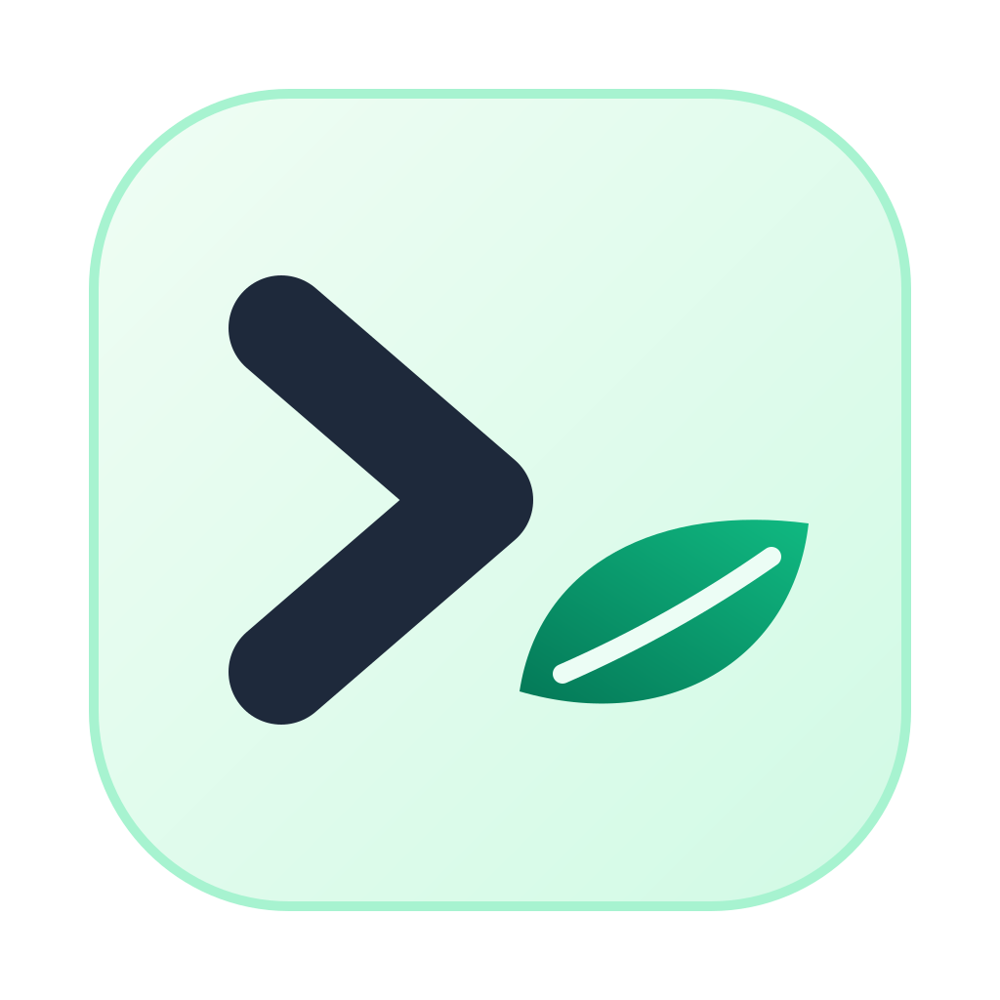
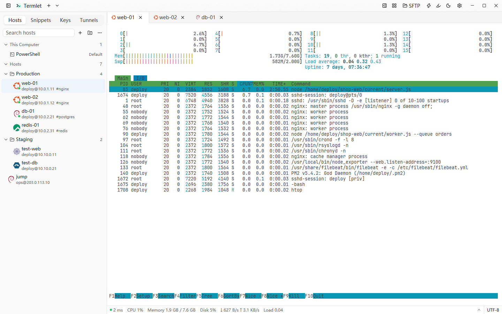

<p align="center"></p>
<h1 align="center">Termlet</h1>
<p align="center">The lightweight SSH client your AI can safely use</p>
<p align="center"><a href="README.md">简体中文</a> · <b>English</b></p>
<p align="center"><a href="https://termlet.dev/en/"><b>Website termlet.dev</b></a> · <a href="https://termlet.dev/en/download/">Download</a> · <a href="docs/guide.en.md">User guide</a> · <a href="CHANGELOG.en.md">Changelog</a></p>
<p align="center"><a href="LICENSE"></a> <a href="https://github.com/termlet/termlet/releases/latest"></a> <a href="https://github.com/termlet/termlet/actions/workflows/ci.yml"></a></p>

<p align="center"></p>

Termlet is an SSH client for Windows, macOS (Apple silicon) and Linux. Its interface and core are both written in Rust (on GPUI / gpui-kit), and the whole app runs as a single process.

It comes with the `termlet` command-line tool, which lets AI tools such as Claude Code run commands and transfer files on the servers you have saved, while the credentials never leave Termlet. Open source under the [AGPL-3.0-or-later](LICENSE), free, and no account needed.

## Features

- **Connections**: SSH, Telnet and serial ports; jump hosts, proxies, ProxyCommand, OpenSSH certificates, X11 forwarding, automatic verification codes; can be opened by bastion hosts.
- **Terminal**: tabs, split panes and workspaces; automatic reconnection and resuming in tmux; sync input and a compose bar; session recording and playback.
- **Host tools**: resource overview, processes, systemd services and timers, Docker and network connections, right beside the terminal.
- **Files**: two-pane SFTP with drag-and-drop transfers, resuming and remote editing; SCP when the server has no SFTP.
- **Keys and tunnels**: a key library, local / dynamic / remote port forwarding, and lending your local proxy to a server.
- **Security**: encrypted credentials, host key verification and an app lock; AI access is allowed per host, dangerous commands need your approval, and every call is audited.
- **Import and sync**: import from 9 sources including ssh_config, Xshell, MobaXterm and Tabby; end-to-end encrypted sync through a folder, WebDAV, S3 or a Gist.
- **Interface**: Simplified Chinese, Traditional Chinese, English, Japanese and Korean; light / dark; interface size 90%–150%.

## Installation

| Platform | Packages | Requirements |
|---|---|---|
| Windows x64 | setup wizard (`.exe`), portable (`.zip`) | Windows 10 1809 or later |
| macOS (Apple silicon) | `.zip` (contains Termlet.app) | macOS 11 or later |
| Linux x64 | `.deb`, `.rpm`, `.AppImage`, `.tar.gz` | glibc 2.35 or later (Ubuntu 22.04, Debian 12 and newer), X11 or Wayland |
| Windows arm64 (experimental) | same as Windows x64 | Windows 10 1809 or later on arm64 |
| Linux arm64 (experimental) | same as Linux x64 | same as Linux x64 |

- Download from the website's [download page](https://termlet.dev/en/download/), or from [Releases](https://github.com/termlet/termlet/releases/latest) on GitHub.
- The arm64 versions are experimental: there is no real hardware, so they are only built and run through the core tests on CI's arm64 runners.
- The macOS and Linux versions haven't been tested on real hardware yet; please report problems in [Issues](https://github.com/termlet/termlet/issues).
- For how to install on each platform, the data folder, updates and uninstalling, see the [user guide](docs/guide.en.md#installation).

### Checking your download

Each release comes with `SHA256SUMS` and its [minisign](https://jedisct1.github.io/minisign/) signature `SHA256SUMS.minisig`. The public keys (the same as in [SECURITY.md](SECURITY.md)):

| Use | Public key | Key ID |
|---|---|---|
| Current (signs releases) | `RWRSYxplUItTcPz4ZAEBJVcK0n3Sy1xPjhO3CNJIVFxbazT7cXsPacBG` | `70538B50651A6352` |
| Offline backup (only used when rotating keys) | `RWR0ioBzciN0EjIEaOwb2jw2Xujxz3oxGYgF8nh1HrPVLkgkqH9dsmog` | `1274237273808A74` |

Put both files and the downloaded package in one folder, and run there:

```
minisign -Vm SHA256SUMS -P RWRSYxplUItTcPz4ZAEBJVcK0n3Sy1xPjhO3CNJIVFxbazT7cXsPacBG
sha256sum -c SHA256SUMS --ignore-missing
```

- The signature passes only if the first command prints `Signature and comment signature verified` and the `Trusted comment` on the next line names the version you downloaded.
- The second command should say `OK` on the line of your file. For macOS and PowerShell, and for installing minisign, see the [user guide](docs/guide.en.md#checking-your-download).
- Build provenance (from 0.3.0 on): `gh attestation verify <file> -R termlet/termlet` lists the workflow and tag that built the file.

## Command-line tool and AI

The `termlet` command lets AI tools run commands and transfer files on your saved servers, without the credentials leaving Termlet.

```bash
termlet ls                                  # list hosts that allow CLI access
termlet exec <host> "uptime"                # run a command; its exit code is passed through
termlet upload <host> ./app.tar.gz /tmp/    # upload one file
termlet skill install                       # install the Agent Skill for Claude Code
termlet mcp                                 # MCP server, started by AI tools from their configuration
```

- Off by default: turn it on under Settings → AI & automation, then allow each host separately.
- Dangerous commands wait for your approval in a dialog, and every call goes into the audit log.
- For all commands, MCP, exit codes and limits, see the [user guide](docs/guide.en.md#command-line-tool-and-ai).

## Documentation

| Document | What's in it |
|---|---|
| [Website](https://termlet.dev/en/) | features, downloads, FAQ |
| [User guide](docs/guide.en.md) | installation, how each feature works, the command-line tool, known limitations |
| [Changelog](CHANGELOG.en.md) | what changed in each version |
| [Security policy](SECURITY.md) | reporting vulnerabilities, release signing keys |
| [Contributing guide](CONTRIBUTING.en.md) | development environment, common commands, tests, releasing |
| [Architecture](docs/rust/技术方案.md) (in Chinese) | design and the reasons behind it |
| [Privacy policy](https://termlet.dev/en/privacy/) | what usage statistics and crash reports collect |

## Contributing

- Bugs and feature requests: open an issue in [Issues](https://github.com/termlet/termlet/issues) with the template, including what "Copy version info" on the About page of Settings gives you.
- Questions and ideas: go to [Discussions](https://github.com/termlet/termlet/discussions).
- Code: open an issue first; contributions require signing the [Contributor License Agreement](docs/CLA.md). See [CONTRIBUTING.en.md](CONTRIBUTING.en.md) for development.
- Security vulnerabilities: don't open a public issue; report them privately as described in [SECURITY.md](SECURITY.md).
- Please follow the [Code of Conduct](CODE_OF_CONDUCT.en.md).

## Acknowledgements

- System and brand logos are from [Simple Icons](https://simpleicons.org) (CC0 1.0; the Debian, Gentoo and Rocky Linux logos are under CC BY-SA and the bash logo under MIT), and the trademarks belong to their respective owners.
- See `licenses/simple-icons.txt` in the installation folder for the logos' authors, sources and licenses; the other third-party licenses (fonts, SFTP file icons, terminal color schemes, Rust dependencies and so on) are in the `licenses` folder too.

## License

- Open source under the [GNU Affero General Public License, version 3 or later (AGPL-3.0-or-later)](LICENSE): you may use, modify and redistribute it free of charge; if you distribute a modified version (including letting others use it over a network), you must make its source code available under the same license.
- The "Termlet" name and logo are not licensed under it; please rename modified versions you distribute, see [TRADEMARK.en.md](TRADEMARK.en.md).
- Third-party components distributed with Termlet are under their own licenses, whose texts are in the `licenses` folder of the installation folder.

Copyright © 2026 ruan
