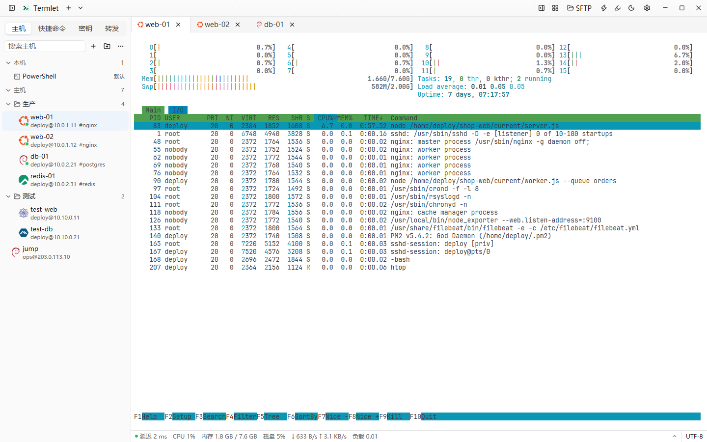

<p align="center"></p>
<h1 align="center">Termlet</h1>
<p align="center">轻巧的 SSH 终端，AI 也能安全上手</p>
<p align="center"><b>简体中文</b> · <a href="README.en.md">English</a></p>
<p align="center"><a href="https://termlet.dev/"><b>官网 termlet.dev</b></a> · <a href="https://termlet.dev/download/">下载</a> · <a href="docs/guide.md">用户指南</a> · <a href="CHANGELOG.md">更新日志</a></p>
<p align="center"><a href="LICENSE"></a> <a href="https://github.com/termlet/termlet/releases/latest"></a> <a href="https://github.com/termlet/termlet/actions/workflows/ci.yml"></a></p>

<p align="center"></p>

Termlet 是 SSH 客户端，支持 Windows、macOS（Apple 芯片）与 Linux。界面与核心都用 Rust 编写（基于 GPUI / gpui-kit），整个应用只有一个进程。

自带 `termlet` 命令行工具：Claude Code 等 AI 工具可以借它在你保存的服务器上执行命令、传输文件，凭据始终留在 Termlet 里。以 [AGPL-3.0-or-later](LICENSE) 开源，免费，无需账号。

## 特性

- **连接**：SSH、Telnet、串口；跳板机、代理、ProxyCommand、OpenSSH 证书、X11 转发、自动填写验证码；可被堡垒机调起。
- **终端**：多 Tab、分屏与工作区；断线重连、tmux 续连；同步输入与撰写栏；会话录制与回放。
- **主机工具**：资源概览、进程、systemd 服务与定时器、Docker、网络连接，就在终端旁边。
- **文件**：SFTP 双栏拖动传输、断点续传、在线编辑；服务器没有 SFTP 时改用 SCP。
- **密钥与转发**：密钥库、本地 / 动态 / 远程端口转发，把本机的代理借给服务器。
- **安全**：凭据加密保存、主机指纹校验、应用锁；AI 访问按主机授权，危险命令要你批准，每次调用都有审计。
- **导入与同步**：从 ssh_config、Xshell、MobaXterm、Tabby 等 9 种来源导入；经文件夹、WebDAV、S3、Gist 端到端加密同步。
- **界面**：简体中文、繁體中文、English、日本語、한국어；浅色 / 深色；界面大小 90%–150%。

## 安装

| 平台 | 包 | 系统要求 |
|---|---|---|
| Windows x64 | 安装向导（`.exe`）、便携版（`.zip`） | Windows 10 1809 及以上 |
| macOS（Apple 芯片） | `.zip`（其中是 Termlet.app） | macOS 11 及以上 |
| Linux x64 | `.deb`、`.rpm`、`.AppImage`、`.tar.gz` | glibc 2.35 及以上（Ubuntu 22.04、Debian 12 起），X11 或 Wayland |
| Windows arm64（实验版） | 同 Windows x64 | arm64 的 Windows 10 1809 及以上 |
| Linux arm64（实验版） | 同 Linux x64 | 同 Linux x64 |

- 下载：官网的[下载页](https://termlet.dev/download/)，备用 GitHub 上的 [Releases](https://github.com/termlet/termlet/releases/latest)。
- arm64 版是实验版：没有真机，只在 CI 的 arm64 运行器上编译、跑核心测试。
- macOS、Linux 版还没有在真机上测试过，遇到问题请在 [Issues](https://github.com/termlet/termlet/issues) 中反馈。
- 各平台的安装方式、数据目录、更新与卸载，见[用户指南](docs/guide.md#安装)。

### 核对下载的文件

每个版本附带 `SHA256SUMS` 与它的 [minisign](https://jedisct1.github.io/minisign/) 签名 `SHA256SUMS.minisig`。公钥（与 [SECURITY.md](SECURITY.md) 中的相同）：

| 用途 | 公钥 | 密钥 ID |
|---|---|---|
| 在用（发布时用它签名） | `RWRSYxplUItTcPz4ZAEBJVcK0n3Sy1xPjhO3CNJIVFxbazT7cXsPacBG` | `70538B50651A6352` |
| 离线备用（只在轮换密钥时使用） | `RWR0ioBzciN0EjIEaOwb2jw2Xujxz3oxGYgF8nh1HrPVLkgkqH9dsmog` | `1274237273808A74` |

把这两个文件与下载的包放在同一个文件夹，在其中运行：

```
minisign -Vm SHA256SUMS -P RWRSYxplUItTcPz4ZAEBJVcK0n3Sy1xPjhO3CNJIVFxbazT7cXsPacBG
sha256sum -c SHA256SUMS --ignore-missing
```

- 第一条显示 `Signature and comment signature verified`，下一行 `Trusted comment` 中是你下载的版本号，签名才算通过。
- 第二条中你下载的文件一行显示 `OK`。macOS、PowerShell 上的命令与安装 minisign 的方法见[用户指南](docs/guide.md#核对下载的文件)。
- 构建来源（0.3.0 起）：`gh attestation verify <文件> -R termlet/termlet` 列出构建它的工作流与标签。

## 命令行工具与 AI

`termlet` 命令让 AI 工具在你保存的服务器上执行命令、传输文件，凭据不离开 Termlet。

```bash
termlet ls                                  # 列出允许命令行访问的主机
termlet exec <主机> "uptime"                 # 执行命令，退出码透传
termlet upload <主机> ./app.tar.gz /tmp/     # 上传单个文件
termlet skill install                       # 给 Claude Code 装 Agent Skill
termlet mcp                                 # MCP 服务，由 AI 工具按配置启动
```

- 默认关闭：在设置的“命令行工具”中开启，每台主机还要单独允许。
- 危险命令先弹窗请你批准，每次调用都记入审计日志。
- 全部命令、MCP、退出码与限制见[用户指南](docs/guide.md#命令行工具与-ai)。

## 文档

| 文档 | 内容 |
|---|---|
| [官网](https://termlet.dev/) | 功能介绍、下载、常见问题 |
| [用户指南](docs/guide.md) | 安装、各项功能的用法、命令行工具、已知限制 |
| [更新日志](CHANGELOG.md) | 每个版本的变化 |
| [安全说明](SECURITY.md) | 报告漏洞、发布文件的签名 |
| [贡献指南](CONTRIBUTING.md) | 开发环境、常用命令、测试、发布 |
| [技术方案](docs/rust/技术方案.md) | 架构与设计取舍 |
| [隐私说明](https://termlet.dev/privacy/) | 使用统计与崩溃报告收集什么 |

## 参与贡献

- 问题与建议：在 [Issues](https://github.com/termlet/termlet/issues) 中按模板新建，附上设置“关于”页中“复制版本信息”的内容。
- 疑问与想法：到[讨论区](https://github.com/termlet/termlet/discussions)。
- 代码：先开 issue 讨论；贡献需签署[贡献者许可协议](docs/CLA.md)，开发说明见 [CONTRIBUTING.md](CONTRIBUTING.md)。
- 安全漏洞：不要公开提 issue，按 [SECURITY.md](SECURITY.md) 私下报告。
- 参与交流请遵守[行为准则](CODE_OF_CONDUCT.md)。

## 致谢

- 系统与品牌标志来自 [Simple Icons](https://simpleicons.org)（CC0 1.0；Debian、Gentoo、Rocky Linux 的标志按 CC BY-SA，bash 的按 MIT），商标归各自所有者。
- 标志的作者、来源与许可见安装目录的 `licenses/simple-icons.txt`；字体、SFTP 文件图标、终端配色、Rust 依赖等其他第三方许可也在 `licenses` 中。

## 许可

- 以 [GNU Affero 通用公共许可证第 3 版或更新的版本（AGPL-3.0-or-later）](LICENSE)开源：可以免费使用、修改与再发布；发布修改后的版本（包括让他人经网络使用）时，要按同一许可证提供源代码。
- “Termlet”名称与标志不随许可证授权，发布修改过的版本时请换名，见 [TRADEMARK.md](TRADEMARK.md)。
- 随程序分发的第三方组件按各自的许可授权，许可文本在安装目录的 `licenses` 中。

版权所有 © 2026 ruan
